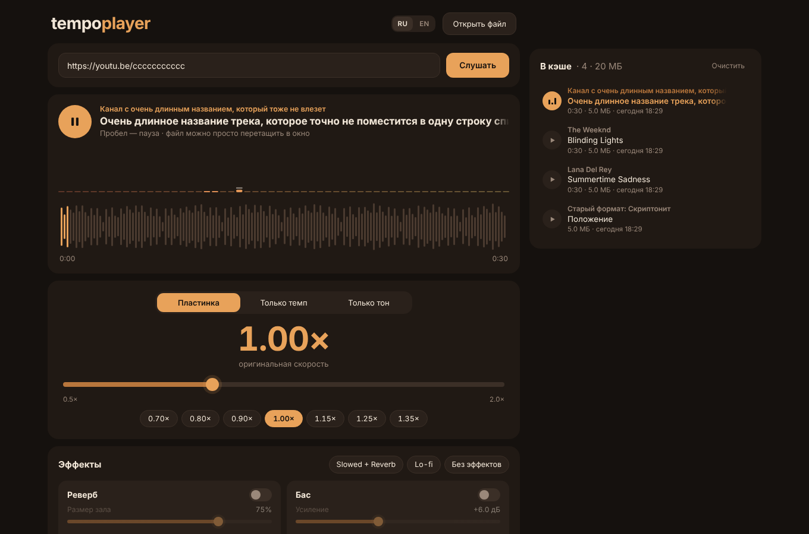

# tempo player

Плеер для **slowed / sped up** музыки: скорость, темп и тон меняются прямо во время воспроизведения.



## Установка и запуск (Windows, PyCharm)

1. Откройте проект в PyCharm и согласитесь создать виртуальное окружение.
2. В терминале PyCharm:
   ```
   python -m pip install -r requirements.txt
   ```
3. Запустите `main.py` (правая кнопка → Run) — плеер откроется **в браузере**.

Звук играет Python на вашем компьютере, браузер — только пульт.
Выключить: просто закройте вкладку (программа выключится через пару секунд; F5 не считается), кнопка «Выключить» внизу страницы или Stop в PyCharm.

ffmpeg для YouTube и m4a ставится автоматически пакетом `imageio-ffmpeg`, отдельно ничего качать не нужно.

## Возможности

- **Открыть файл** — mp3, wav, flac, ogg, m4a, opus…
- **Ссылка на YouTube** — вставьте и нажмите Enter, аудио скачается и сразу заиграет
- **Три режима скорости**
  - *Пластинка* — темп и тон вместе (классический slowed / nightcore)
  - *Только темп* — быстрее/медленнее, голос на своей высоте
  - *Только тон* — выше/ниже на ±12 полутонов, темп прежний
- **Эффекты** на лету: реверб, бас, эхо, lo-fi (приглушение + треск пластинки); пресеты «Slowed + Reverb», «Lo-fi»
- **В кэше** — все треки, уже скачанные с YouTube, подгружаются при запуске; исполнитель и название — отдельными строками, длинные прокручиваются при наведении; клик — мгновенно играет, × — удалить из кэша
- **Спектр** в реальном времени — то, что реально звучит, уже с эффектами
- Волна трека с перемоткой по клику
- Два языка интерфейса: русский (по умолчанию) и английский — переключатель RU / EN в шапке
- Веб-версия: файл можно перетащить в окно, ссылку — вставить Ctrl+V в любом месте страницы

## Горячие клавиши

| Клавиша | Действие |
|---|---|
| Пробел | play / pause |
| ← / → | скорость ±0.05 (в режиме тона ±1 полутон) |
| 0 | сброс |
| 1 / 2 / 3 | режим: пластинка / темп / тон |
| ↑ / ↓ | громкость |

## Устройство

```
main.py                  точка входа
tempo_player/
  web.py                 веб-сервер (только 127.0.0.1) + static/index.html
  controller.py          состояние плеера для веб-версии
  effects.py             эффекты (pedalboard) + генератор треска пластинки
  history.py             когда слушали / длительность для списка «В кэше» (%APPDATA%\\tempo-player\\history.json)
  resample.py            качественный ресемплер (windowed sinc)
  engine.py              аудиодвижок: WSOLA -> ресемплер -> звуковая карта
  stretch.py             потоковый time-stretch (WSOLA), меняет темп без смены тона
  sources.py             чтение файлов, скачивание с YouTube (yt-dlp)
  theme.py               тёплая тёмная палитра
```

Подробный план функций — в [SPEC.md](SPEC.md).
